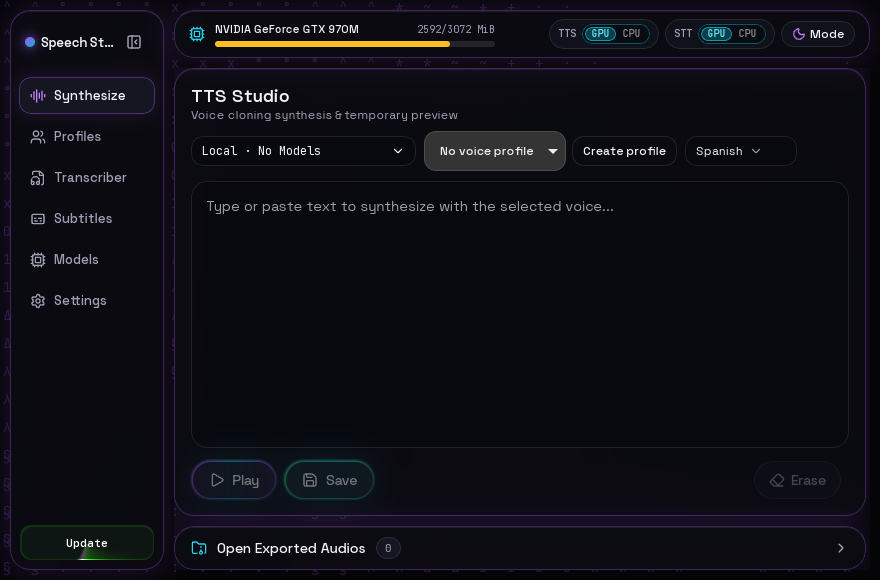
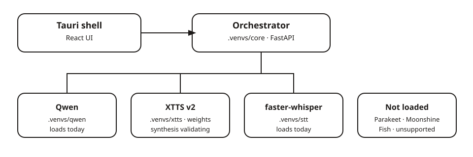
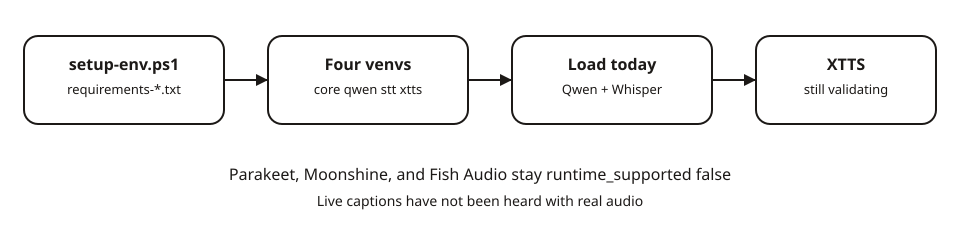

[English](README.md) | **Español**

# Speech Studio

Aplicación local de escritorio en Windows para síntesis de voz, clonación de voz y transcripción — publicada por **Rainbow Technology**.

[](https://github.com/xyz-rainbow/xyz-speechstudio/actions/workflows/ci.yml) [](https://github.com/xyz-rainbow/xyz-speechstudio/releases/tag/v0.2.1) [](LICENSE) [](https://www.microsoft.com/windows) [](https://tauri.app/) [](https://www.python.org/)

Speech Studio `v0.2.1` es un shell de escritorio [Tauri 2](https://tauri.app/) (React + TypeScript + Rust) conectado a un orquestador FastAPI en Python, con **[CrispASR](https://github.com/CrispStrobe/CrispASR)** integrado (C++/CUDA y CPU en modo `--server` persistente en VRAM), un entorno Python unificado **`pytts`** y motor nativo CPU **eSpeak NG** (`espeakng-loader`). Windows 10/11 (x64) es la plataforma principal; **Ubuntu 24.04** permite compilar el shell y probar TTS/STT en desarrollo, mientras que Subtítulos en vivo, lectura por UI Automation y notificaciones toast son específicos de Windows.








## Funciones

- **TTS Studio (`Synthesize`)** — división inteligente de textos largos por secciones y palabras con precarga progresiva en segundo plano para iniciar el audio antes; hueco compartido entre barra de carga y `<ChunkedAudioPlayer>` (timeline con buffer, seek, volumen/mute y velocidad `0.75x–3x`); botón **Play → Stop** rojo/rosa que cancela la generación en backend (`POST /api/tts/cancel`); isla flotante `FloatingPlaybackIsland` verde lima al cambiar de pestaña; guardado unificado (**Save**) en `outputs_dir`; y limpieza automática de temporales en `data/tmp/play_session/`.
- **Perfiles de voz (`Profiles`)** — normalización automática no destructiva a WAV mono 24 kHz, previsualización Play/Pause del audio de referencia, aviso en clips `>15s` con botón no destructivo **Trim to 12s**, contadores `(0)/(1)` por motor, estado `Ready` automático en motores de clonación inline y transcripción automática con Parakeet/Whisper.
- **Transcriptor (`Transcriber`)** — transcribe archivos `.wav`, `.mp3`, `.m4a`, `.flac` u `.opus` con CrispASR local (**Parakeet TDT 0.6B v3**, **Whisper**) / `faster-whisper` o endpoints STT externos, devolviendo texto completo, segmentos con marcas de tiempo y botón explícito de limpieza (`×`).
- **Subtítulos en vivo (`Subtitles`)** — selector paginado `2×2` estilo Discord (`WindowPickerModal`), enumeración segura de ventanas (`spawn_blocking` + `IsHungAppWindow`), captura WASAPI PCM por proceso en Windows y overlay flotante en tiempo real.
- **Modelos y Hub (`Models`)** — pestaña **Featured** agrupada por familia con variantes y cuantizaciones, **Explore Hub** conectado a Hugging Face con filtro `Ready`, **Import** desde Hugging Face / ModelScope / URL directa / archivos locales y selector **`CrispASR | Python`** en tarjetas de modelos duales (`Qwen3-TTS`, `F5-TTS`).
- **CLI global (`speechstudio`)** — se conecta al backend en ejecución mediante `data/runtime.json` o arranca un orquestador temporal headless (`play`, `status`, `models`, `profiles`, `transcribe`, `config`, `endpoints`, `--json`).
- **API local compatible con OpenAI y Endpoints externos** — `POST /v1/audio/speech` y `POST /v1/audio/transcriptions` (`127.0.0.1` o `0.0.0.0` con token Bearer obligatorio), además de plantillas para OpenAI, Groq, ElevenLabs y Deepgram con prueba de conexión y copia de cURL.
- **Integración de escritorio en Windows** — ventana fija de `880×580` sin redimensionado, bandeja del sistema, diálogo de confirmación al cerrar (**Minimizar** o **Cerrar y Apagar**), inicio automático con el sistema (`ON | OFF`), medidor de VRAM NVIDIA, selectores GPU/CPU, atajo global UI Automation para leer el texto seleccionado, persistencia de estado entre pestañas y avisos toast al iniciar (`0%`) y completar (`100%`) descargas mediante `scripts/notify.ps1`.

### Motores TTS verificados (`v0.2.1`)

Los 10 motores TTS locales instalados han sido verificados de extremo a extremo generando audio real y comprobando su transcripción con NVIDIA Parakeet:

| Runtime | Motores | Notas |
| --- | --- | --- |
| **CrispASR** (C++/CUDA y CPU `--server`) | **Qwen3-TTS** (`1.7B Base`, `0.6B Base`, `CustomVoice`), **Kokoro 82M** (54 voces auto-empaquetadas a GGUF v3), **Piper**, **Chatterbox Turbo**, **CosyVoice3 0.5B** | Permanece cargado en VRAM entre pulsaciones de Play y se libera al pulsar **Eject**; el catálogo también incluye `Chatterbox Multilingual`, `F5-TTS GGUF F16`, `IndexTTS 1.5` y `Orpheus 3B` |
| **Entorno unificado `pytts`** (`.venvs/pytts` / `runtime/envs/pytts`) | **Coqui XTTS v2**, **F5-TTS Spanish** (`F5TTS_Base` + recorte automático `<=11s` con transcripción emparejada), **Fish Speech 1.5** (`v1.5.1`), **KittenTTS 2 Mini** (ONNX + `voices_<lang>.npz` multilingüe) | Los cuatro motores Python comparten un único entorno virtual |
| **Nativo en CPU** | **eSpeak NG** (`espeak-ng.dll` vía `espeakng-loader` / `ctypes`) | Corre directamente en el orquestador `core` sin servidores externos |
| **Windows SAPI 5** | **SAPI 5 / Loquendo**, IVONA y voces OneCore | Usa las voces ya instaladas en Windows, incluidos los dialectos regionales |

## Requisitos

- Windows 10 u 11 (x64). Instalador Inno Setup: **`SpeechStudio_0.2.1_Setup.exe`** ([GitHub Releases `v0.2.1`](https://github.com/xyz-rainbow/xyz-speechstudio/releases/tag/v0.2.1)), editor **Rainbow Technology** y ruta por defecto `C:\Program Files\Rainbow Technology\Speech Studio` (también disponible en modo portable).
- Binarios CrispASR CUDA (`cuda/`) y CPU (`cpu/`) en `runtime/bin/` (`scripts/fetch-crispasr.ps1`).
- [`uv`](https://docs.astral.sh/uv/) y Python 3.12 de 64 bits (para que `installer/setup-env.ps1` prepare `runtime/envs/core` y `runtime/envs/pytts`).
- Solo si compilas desde código fuente: [Node.js](https://nodejs.org/) 20+, Rust estable y [requisitos de Tauri 2 en Windows](https://v2.tauri.app/start/prerequisites/).
- Opcional: GPU NVIDIA con driver reciente (`nvidia-smi` / NVML) para aceleración CUDA y medidor de VRAM; módulo PowerShell [BurntToast](https://github.com/Windos/BurntToast) para notificaciones toast.

### Linux (Ubuntu 24.04) — desarrollo

Instala los [requisitos de Tauri en Linux](https://v2.tauri.app/start/prerequisites/):

```bash
sudo apt update
sudo apt install -y libwebkit2gtk-4.1-dev build-essential curl wget file \
  libxdo-dev libssl-dev libayatana-appindicator3-dev librsvg2-dev
```

`installer/setup-env.ps1` es solo Windows. En Linux, crea `core` y `pytts` con `uv` (`bin/python` en lugar de `Scripts/python.exe`):

```bash
uv venv --python 3.12 runtime/envs/core
uv pip install --python runtime/envs/core/bin/python -r installer/requirements-core.txt

uv venv --python 3.12 runtime/envs/pytts
uv pip install --python runtime/envs/pytts/bin/python torch torchaudio --torch-backend=auto
uv pip install --python runtime/envs/pytts/bin/python -r installer/requirements-pytts.txt
```

Después ejecuta `npm install` y `npm run tauri dev`. En Unix el sidecar usa grupos de procesos en vez de Job Objects y `notify-send` para notificaciones.

## Instalación (Windows desde el código fuente)

```powershell
git clone https://github.com/xyz-rainbow/xyz-speechstudio.git
cd xyz-speechstudio
npm install
powershell -NoProfile -ExecutionPolicy Bypass -File .\installer\setup-env.ps1 -AppRoot (Get-Location).Path
```

`setup-env.ps1` crea dos entornos en `runtime\envs\` (en árboles locales de desarrollo también detecta `.venvs\`):

| Venv | Requirements | Uso |
| --- | --- | --- |
| `runtime\envs\core` | `installer/requirements-core.txt` | Orquestador (`backend.orchestrator.main`) + motor CPU nativo **eSpeak NG** |
| `runtime\envs\pytts` | PyTorch + `installer/requirements-pytts.txt` | Entorno Python TTS unificado (**XTTS v2**, **F5-TTS**, **Fish Speech 1.5**, **KittenTTS 2 Mini**) |

Los pesos de los modelos no se suben a git y se descargan desde el botón **`+`** de **Modelos** (`Featured`, `Explore Hub`, `Import`).

## Uso

```powershell
npm run tauri dev
```

1. En **Modelos**, abre **`+`** y descarga un modelo TTS (por ejemplo **Qwen3-TTS**, **Kokoro 82M**, **XTTS v2** o **F5-TTS Spanish**) y un STT (**Parakeet TDT 0.6B v3** o **faster-whisper**).
2. En **Perfiles** (para motores con clonación), añade tu audio de referencia (con preview y recorte opcional no destructivo a 12s) y guarda el perfil.
3. En **Sintetizar**, elige modelo y voz/perfil, escribe o pega el texto y pulsa **Reproducir** (**Stop** para detener) o **Guardar** (exporta un WAV a `outputs_dir`).
4. En **Transcriptor** puedes transcribir archivos de audio, y en **Subtítulos** capturar audio en tiempo real de cualquier ventana abierta.

Al cerrar la ventana puedes elegir entre **Minimizar la App** en la bandeja o **Cerrar y Apagar**.

### API local

En **Ajustes**, activa *Servir API local compatible con OpenAI* (`127.0.0.1` o `0.0.0.0` con token Bearer obligatorio):

```powershell
curl.exe -X POST "http://127.0.0.1:<puerto>/v1/audio/speech" `
  -H "Authorization: Bearer <token>" `
  -H "Content-Type: application/json" `
  -d "{\"input\":\"Hola\",\"voice\":\"<id-de-perfil>\",\"response_format\":\"wav\"}" `
  --output speech.wav

curl.exe -X POST "http://127.0.0.1:<puerto>/v1/audio/transcriptions" `
  -H "Authorization: Bearer <token>" `
  -F "file=@audio.wav" `
  -F "model=parakeet-tdt-0.6b-v3-gguf"
```

## Configuración

Los ajustes se guardan en `data/settings.json` (se crea en la primera ejecución):

| Clave | Significado |
| --- | --- |
| `language` | Idioma de la UI: `en` o `es` |
| `theme`, `accent` | `dark` / `light` y acento (`cyber`, `emerald`, `amber`, `rose`) |
| `models_dir`, `outputs_dir` | Carpetas propias; vacío equivale a `data/models` y `data/outputs` |
| `chunking_enabled`, `chunking_max_chars` | Dividir textos largos en secciones al reproducir (`180 / 300 / 500` o deslizador) |
| `model_runtimes` | Preferencia de runtime por modelo (`crispasr` o `python`) en motores duales |
| `tts_device`, `stt_device` | `gpu` o `cpu` |
| `tts_source`, `stt_source` | `local` o `endpoint` |
| `active_tts_model`, `active_stt_model` | Identificadores del catálogo |
| `api_endpoint_enabled`, `api_bind_host`, `api_fixed_port`, `api_bearer_token` | API local compatible con OpenAI |
| `read_hotkey` | Atajo global UI Automation para «leer la selección» |
| `notifications_enabled` | Notificaciones toast de Windows |
| `external_endpoints` | Endpoints TTS/STT externos guardados |

No subas `data/`, perfiles de voz, claves de API ni pesos de modelos; están excluidos en `.gitignore`.

## Desarrollo

| Comando | Qué hace |
| --- | --- |
| `npm run dev` | Solo UI de Vite (`http://localhost:1420`) |
| `npm run build` | Comprobación TypeScript (`tsc --noEmit`) + bundle Vite |
| `npm run tauri build --no-bundle` | Compila `src-tauri/target/release/speech-studio.exe` |
| `.\installer\windows\build.ps1` | Compila el instalador Inno Setup `installer/Output/SpeechStudio_<ver>_Setup.exe` |
| `python scripts/sync_version.py --check` | Verifica la versión sincronizada en Tauri, npm, Cargo, locales e Inno Setup |
| `python -m compileall backend` | Comprueba sintaxis de orquestador y workers |

## Documentación

- [CHANGELOG.md](CHANGELOG.md) — historial completo de cambios (`v0.2.1`).
- [docs/releases/v0.2.1.md](docs/releases/v0.2.1.md) — notas de lanzamiento `v0.2.1`.
- [docs/crispasr-research.md](docs/crispasr-research.md) — investigación de backends C++ en CrispASR y entorno unificado `pytts`.
- [docs/README.md](docs/README.md) — especificación, problemas conocidos y notas de la app.

## Contribuir

Se aceptan issues, debates y pull requests. Lee [CONTRIBUTING.es.md](CONTRIBUTING.es.md) y el [Código de conducta](CODE_OF_CONDUCT.es.md). Los informes de seguridad van por [SECURITY.md](SECURITY.md), no por issues públicos.

## Patrocinio

Si el proyecto te resulta útil, puedes [patrocinar a xyz-rainbow](https://github.com/sponsors/xyz-rainbow). El resto de plataformas está en [`.github/FUNDING.yml`](.github/FUNDING.yml).

## Licencia

Propietaria — todos los derechos reservados. Copyright (c) 2026 Rainbow Technology (xyz-rainbow).

El código se puede ver y evaluar en este repositorio. Queda prohibido copiarlo, redistribuirlo, sublicenciarlo, publicar forks o trabajos derivados, y cualquier uso comercial o en producción, salvo permiso escrito. Se admiten issues y pull requests. El fork en GitHub solo está permitido para preparar pull requests hacia este repositorio.

Consulta [LICENSE](LICENSE) para el texto completo, incluida la cesión de contribuciones, y [CONTRIBUTING.es.md](CONTRIBUTING.es.md) si quieres enviar un cambio.
