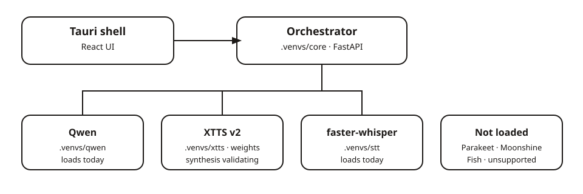
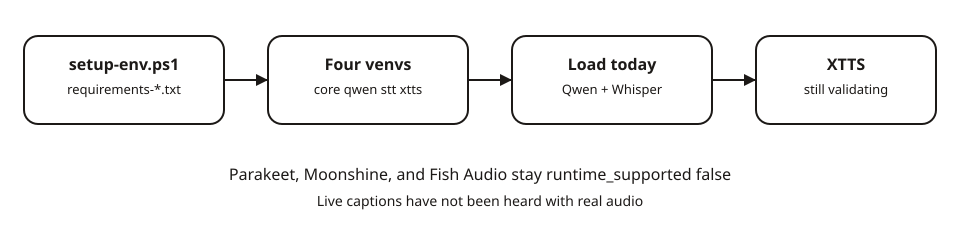

**English** | [Español](README.es.md)

# Speech Studio

Local Windows desktop app for text-to-speech, voice cloning, and transcription.

[](https://github.com/xyz-rainbow/xyz-speechstudio/actions/workflows/ci.yml) [](LICENSE) [](https://www.microsoft.com/windows) [](https://tauri.app/) [](https://www.python.org/)

Speech Studio is a [Tauri 2](https://tauri.app/) desktop shell (React + TypeScript + Rust) with a Python FastAPI orchestrator. It runs **Qwen3-TTS** locally for synthesis and voice profiles, and **faster-whisper** for file transcription. Windows is the primary platform (version `0.1.0`); **Ubuntu 24.04** can build and run the shell plus Python backend for TTS/STT development. Live captions, read-selection UI Automation, and Windows toasts remain Windows-only.






## Features

- **TTS Studio** — synthesize with a cloned voice profile, preview playback, and export WAV history (save, save-as, reveal in Explorer, delete).
- **Voice profiles** — create profiles from reference audio and a transcript; extract `.spk` / `.rvq` embeddings with the Qwen worker; transcribe the reference clip when needed.
- **Transcriber** — transcribe `.wav`, `.mp3`, `.m4a`, `.flac`, or `.opus` files with local faster-whisper (tiny, base, small, medium, large-v3-turbo) or an external STT endpoint. Returns full text plus timestamped segments. Language can be auto-detected.
- **Models & endpoints** — catalog entries carry `capabilities` (install mode, voice mode, languages). **Qwen and faster-whisper load today.** Place [CrispASR](https://github.com/CrispStrobe/CrispASR) at `runtime/bin/crispasr` (see `scripts/fetch-crispasr.ps1`) to enable Piper and F5 GGUF synthesis. Coqui XTTS v2 has a worker under `runtime/envs/xtts`; Parakeet, Moonshine, and Fish stay catalog-only until their runtime lands.
- **Optional local API** — OpenAI-compatible `POST /v1/audio/speech` and `POST /v1/audio/transcriptions`, with an on/off switch, bind host (`127.0.0.1` or `0.0.0.0`), fixed or dynamic port, and a Bearer token. Listening on `0.0.0.0` requires a non-empty token. Settings will not save that combination, and the orchestrator will not serve it.
- **External endpoints** — presets for OpenAI, Groq, ElevenLabs, and Deepgram, plus custom OpenAI-compatible URLs. Test connection and copy a cURL snippet from Settings.
- **Windows desktop shell** — system tray (show/hide, captions shortcut, eject models, exit), single-instance, close-to-tray, NVIDIA VRAM meter, GPU or CPU device selectors, and a global hotkey that reads the selected text via UI Automation (the clipboard is not used) and sends it to TTS Studio.
- **Notifications** — optional Windows toast notifications through `scripts/notify.ps1` (BurntToast / [xyz-windows-notify](https://github.com/xyz-rainbow/xyz-windows-notify)).
- **UI** — English or Spanish (follows the in-app language setting), dark/light themes, accent colors, and an optional ASCII background.
- **Live Captions overlay** — the Subtitles tab picks an app and streams its process-loopback audio to the selected STT (local faster-whisper or an external endpoint). The overlay shows that text. A live capture session has not been tried yet.

## Requirements

- Windows 10 or 11. The Rust sidecar, UI Automation hotkey, tray, toasts, and `runtime\envs\*\Scripts\python.exe` paths are Windows-specific.
- [Node.js](https://nodejs.org/) 20+ and npm.
- Rust stable and the [Tauri 2 Windows prerequisites](https://v2.tauri.app/start/prerequisites/).
- 64-bit Python 3.11 or newer.
- Optional: an NVIDIA GPU and a recent driver (`nvidia-smi` / NVML) for GPU inference and the VRAM meter. CPU mode is supported.
- Optional: the PowerShell [BurntToast](https://github.com/Windos/BurntToast) module for toasts.

Virtual environments come from [`installer/setup-env.ps1`](installer/setup-env.ps1) (`uv`, Python 3.12) and the pinned files [`installer/requirements-core.txt`](installer/requirements-core.txt), [`requirements-qwen.txt`](installer/requirements-qwen.txt), [`requirements-stt.txt`](installer/requirements-stt.txt), and [`requirements-xtts.txt`](installer/requirements-xtts.txt). The Windows package is Inno Setup: `installer/Output/SpeechStudio_0.1.0_Setup.exe`. A silent clean install on 24 Nov 2026 wrote the app to `C:\Program Files (x86)\XYZ-Productions\Speech Studio`. `setup-env.ps1` exited 0 and created the `runtime/envs`. A silent `/DIR` pointing at another folder was ignored. The template default is `{autopf}\XYZ-Productions\Speech Studio`. MSI and NSIS bundles from `tauri build` do not install Python. `uv` has to be on the machine. Model weights are not in the installer.

### Linux (Ubuntu 24.04) — development

Install [Tauri prerequisites](https://v2.tauri.app/start/prerequisites/) for Linux, for example:

```bash
sudo apt update
sudo apt install -y libwebkit2gtk-4.1-dev build-essential curl wget file \
  libxdo-dev libssl-dev libayatana-appindicator3-dev librsvg2-dev
```

`installer/setup-env.ps1` is Windows-only. On Linux, create the same environments with `uv` and the requirements files (`bin/python`, not `Scripts/python.exe`):

```bash
uv venv --python 3.12 runtime/envs/core
uv pip install --python runtime/envs/core/bin/python -r installer/requirements-core.txt
uv venv --python 3.12 runtime/envs/qwen
uv pip install --python runtime/envs/qwen/bin/python -r installer/requirements-qwen.txt
uv venv --python 3.12 runtime/envs/stt
uv pip install --python runtime/envs/stt/bin/python -r installer/requirements-stt.txt
```

XTTS also needs PyTorch before `installer/requirements-xtts.txt` (`uv pip install --python runtime/envs/xtts/bin/python torch torchaudio torchcodec --torch-backend=auto`, after `uv venv --python 3.12 runtime/envs/xtts`). Then `npm install` and `npm run tauri dev`. The Rust sidecar uses a process group on Unix instead of Windows Job Objects. On Linux, `notify-send` is used when notifications are enabled. Linux CI builds the shell and does not produce an AppImage or a `.deb`.

## Installation

```powershell
git clone https://github.com/xyz-rainbow/xyz-speechstudio.git
cd xyz-speechstudio
npm install
powershell -NoProfile -ExecutionPolicy Bypass -File .\installer\setup-env.ps1 -AppRoot (Get-Location).Path
```

`setup-env.ps1` is the official bootstrap. It needs [`uv`](https://docs.astral.sh/uv/) and Python 3.12, and it creates four environments under `runtime\envs\` (the shell looks for `Scripts\python.exe` on Windows):

| Venv | Requirements | Used for |
| --- | --- | --- |
| `runtime\envs\core` | `installer/requirements-core.txt` | Orchestrator (`backend.orchestrator.main`) + native eSpeak NG CPU engine |
| `runtime\envs\pytts` | `installer/requirements-pytts.txt` | Unified Python TTS venv for XTTS v2 (`coqui-tts==0.28.0`), F5-TTS Spanish (`f5-tts`), Fish Speech 1.5 (`fish-speech @ v1.5.1`), and KittenTTS 2 Mini (`onnxruntime` + `phonemizer`) |
| `runtime\envs\qwen` | `installer/requirements-qwen.txt` | Legacy Qwen Python worker (`realtimetts-qwen-native`) |
| `runtime\envs\stt` | `installer/requirements-stt.txt` | faster-whisper worker |
| `runtime\envs\xtts` | `installer/requirements-xtts.txt` | Standalone Coqui XTTS v2 fallback venv |

Models that support both CrispASR C++ and Python (`Qwen3-TTS`, `F5-TTS`) expose a per-model **CrispASR | Python** toggle on their card in **Models**; CrispASR keeps models warm in VRAM via persistent `--server` and frees them immediately when clicking **Eject** or switching to a Python GPU worker. Models without a CrispASR backend (`XTTS v2`, `Fish Speech 1.5`, `KittenTTS 2 Mini`, `eSpeak NG`) run exclusively on their native/Python runtime.

Download a Qwen3-TTS GGUF pair (talker + tokenizer) and a faster-whisper model from the in-app **Models** view, or place them in the configured models folder. Built-in Qwen builds come from [`Serveurperso/Qwen3-TTS-GGUF`](https://huggingface.co/Serveurperso/Qwen3-TTS-GGUF); Whisper builds come from the Systran `faster-whisper-*` repos. XTTS checkpoint weights are not in git (Coqui Public Model License). On this tree the weights are already on disk; a real synthesis may still be validating. A load failed once because `six` was missing, until `pip install six` (`six` is now pinned). Parakeet, Moonshine, and Fish Audio do not load.

## Usage

```powershell
npm run tauri dev
```

This starts the Vite UI and the Tauri window. The Rust sidecar launches the orchestrator from `runtime\envs\core` and writes `data/tmp/orchestrator.stderr.log`.

1. Open **Models**, download or select a TTS model and an STT model, and load the workers (GPU or CPU from the top bar).
2. Open **Profiles**, add a reference audio file and its transcript, then extract the voice.
3. Open **Synthesize**, pick the profile, enter text, and use **Play** or **Save** (exports a WAV and lists it in history).
4. Open **Transcriber** to transcribe an audio file.

Closing the main window hides it to the tray; use **Exit** in the tray to quit. The app enforces a single instance and focuses the existing window if you start it again.

### Local API

In **Settings**, enable *Serve Local OpenAI-Compatible API*. Restart the app if you change the bind host or the fixed port (`0` means a dynamic port). If a Bearer token is set, send it as `Authorization: Bearer <token>`. Binding `0.0.0.0` requires a non-empty token; that combination is rejected on save and before the orchestrator listens.

```powershell
curl.exe -X POST "http://127.0.0.1:<port>/v1/audio/speech" `
  -H "Authorization: Bearer <token>" `
  -H "Content-Type: application/json" `
  -d "{\"input\":\"Hello\",\"voice\":\"<profile-id>\",\"response_format\":\"wav\"}" `
  --output speech.wav

curl.exe -X POST "http://127.0.0.1:<port>/v1/audio/transcriptions" `
  -H "Authorization: Bearer <token>" `
  -F "file=@audio.wav" `
  -F "model=faster-whisper-base"
```

`GET /health` reports whether the orchestrator is up. The API stays off until the setting is enabled.

## Configuration

Settings are stored in `data/settings.json` (created on first run). Useful keys:

| Key | Meaning |
| --- | --- |
| `language` | UI language: `en` or `es` |
| `theme`, `accent` | `dark` / `light` and neon accent (`cyber`, `emerald`, `amber`, `rose`) |
| `models_dir`, `outputs_dir` | Custom folders; empty means `data/models` and `data/outputs` |
| `tts_device`, `stt_device` | `gpu` or `cpu` |
| `tts_source`, `stt_source` | `local` or `endpoint` |
| `active_tts_model`, `active_stt_model` | Catalog model ids |
| `api_endpoint_enabled`, `api_bind_host`, `api_fixed_port`, `api_bearer_token` | Local API |
| `read_hotkey` | Global accelerator for “read selection” |
| `notifications_enabled` | Windows toasts |
| `external_endpoints` | Saved TTS/STT endpoint configs |

Do not commit `data/`, voice profiles, API keys, or model weights. They are gitignored.

## Development

| Command | What it does |
| --- | --- |
| `npm run dev` | Vite UI only (`http://localhost:1420`) |
| `npm run build` | Typecheck (`tsc --noEmit`) and Vite production build |
| `npm run tauri dev` | Full desktop app |
| `python -m compileall backend` | Syntax-check the orchestrator and workers |

Lightweight tests live in `tests/` and run in CI (`pytest`). The `spikes/` tree holds earlier end-to-end experiments and is not part of CI.

See [CONTRIBUTING.md](CONTRIBUTING.md) for pull request conventions.

## Documentation

[docs/README.md](docs/README.md) indexes the changelog, the community spec, known issues, and the living app notes in [docs/app/](docs/app/README.md).

## Contributing

Issues, discussions, and pull requests are welcome. Please read [CONTRIBUTING.md](CONTRIBUTING.md) and the [Code of Conduct](CODE_OF_CONDUCT.md). Security reports go through [SECURITY.md](SECURITY.md), not public issues.

## Sponsor

If the project is useful, you can [sponsor xyz-rainbow](https://github.com/sponsors/xyz-rainbow). Other platforms are listed in [`.github/FUNDING.yml`](.github/FUNDING.yml) (GitHub Sponsors, Patreon, Ko-fi, Buy Me a Coffee, PayPal).

## License

Proprietary — all rights reserved. Copyright (c) 2026 Rainbow Technology (xyz-rainbow).

The source may be viewed and evaluated in this repository. Copying, redistribution, sublicensing, published forks, derivative works, and any commercial or production use are prohibited without prior written permission. Issues and pull requests are welcome. A GitHub fork is allowed only to prepare pull requests to this repository.

See [LICENSE](LICENSE) for the full terms, including the contribution assignment, and [CONTRIBUTING.md](CONTRIBUTING.md) if you want to send a change.
