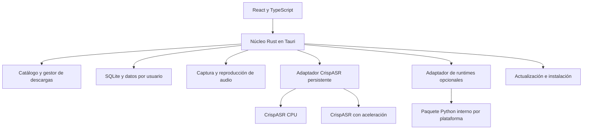

# Arquitectura e instalación de Speech Studio

## Decisiones del producto

El usuario ha solicitado una reorganización profunda, instaladores multiplataforma y ejecución en equipos sin Python instalado. El núcleo se entregará con sus dependencias. Los modelos se descargarán desde Models. Los motores que necesiten Python tendrán paquetes internos opcionales y autocontenidos.

La actualización desde la aplicación es un recorrido principal del producto. La instalación, la actualización y la recuperación se validarán desde paquetes reales en Windows, macOS y Linux.

## Arquitectura objetivo

Rust será responsable de procesos, cancelación, sesiones, catálogo, descargas, persistencia, permisos de escritorio y actualización. La UI consumirá comandos y eventos tipados. El servicio HTTP compatible con OpenAI compartirá las mismas operaciones del núcleo.

CrispASR será el motor principal. Se empezará con su proceso persistente para mantener el aislamiento ante fallos nativos. Su C ABI se evaluará después de medir la sobrecarga y comprobar estabilidad y cancelación. Los modelos de TTS y STT podrán conservar sesiones separadas cuando el presupuesto de memoria permita su uso simultáneo.

## Compatibilidad de modelos

La aplicación registrará versión y hash del binario, backends compilados, formato exacto de pesos, archivos auxiliares, idiomas, voces, clonación, streaming y aceleradores disponibles. La compatibilidad declarada por un backend se comprobará con los archivos que necesita la variante del modelo.

El binario CPU local consultado el 27 de noviembre declara 144 backends. Incluye Qwen3-TTS, F5-TTS, Kokoro, Piper, Whisper, Parakeet y Moonshine. Esa consulta no encontró XTTS, Fish Speech ni Kitten en los nombres de backend. Los checkpoints Python existentes de F5 Spanish requieren validar una conversión y una síntesis de referencia antes de ofrecer un cambio de runtime.

Los motores opcionales compartirán un protocolo de operaciones y eventos. Los adaptadores propios de cada familia conservarán su lógica de carga y síntesis. Sus procesos se mantendrán calientes durante una sesión y terminarán al expulsar el modelo o cerrar la aplicación. La instalación de paquetes se realizará por versión y plataforma, con integridad comprobada y activación atómica.

El proceso de desarrollo puede usar entornos aislados. El usuario final recibirá ejecutables y runtimes completos. El instalador deberá completar la instalación sin Python, uv, pip, Node ni Rust en PATH. Las rutas `.venvs` existentes se mantendrán como compatibilidad durante la migración y se retirarán cuando los motores instalados dispongan de un reemplazo validado.

## Model Hub

El catálogo describirá cada modelo en un manifiesto versionado. Las tarjetas de Models y Featured consumirán la misma entrada e incluirán idiomas, tipo de voz, tamaño, requisitos, fuente y compatibilidad real.

La instalación comprobará espacio y compatibilidad, descargará a un directorio temporal, verificará integridad y estructura y activará la versión completa. La aplicación distinguirá descarga, verificación, instalación, disponibilidad y carga. Cancelar o reintentar conservará el registro y los archivos consistentes. Un modelo aparecerá como instalado después de verificar sus archivos obligatorios.

Loquendo TTS 7 tendrá una entrada propia en Models y Featured. La detección separará las voces Loquendo de las demás voces SAPI y comprobará arquitectura. La instalación desde Releases requiere un instalador real y permiso de redistribución. Hasta disponer de ese paquete, la tarjeta podrá detectar voces y ejecutar un instalador seleccionado por el usuario. El manifiesto indicará Windows como plataforma del runtime SAPI.

## Audio TTS

Cada generación tendrá una sesión, fragmentos ordenados, un estado de cancelación y un presupuesto de memoria. La planificación del siguiente fragmento empezará mientras se reproduce el actual. El motor conservará el modelo cargado.

La reproducción continua usará muestras PCM con formato y reloj definidos. Se evaluará la planificación con Web Audio o AudioWorklet frente al reproductor actual de dos elementos de audio, midiendo huecos, uso de memoria y soporte de los WebViews de cada sistema. Las pausas lingüísticas se conservarán. Pausar, buscar, cambiar de texto y cancelar invalidarán los resultados de sesiones anteriores.

Las pruebas incluirán fragmentos que llegan tarde, respuesta vacía, WAV con cabecera incorrecta, cambio de frecuencia de muestreo, búsqueda entre fragmentos y cancelación durante la síntesis. El audio guardado conservará el mismo orden que el reproducido.

## Subtítulos en vivo

La captura producirá PCM con marcas temporales basadas en muestras. Un buffer acotado y el detector de voz alimentarán ventanas de STT. La aplicación evitará acumular trabajo indefinidamente cuando el reconocimiento vaya más lento que el audio.

Los eventos incluirán sesión, segmento, secuencia, tiempo de inicio y fin, texto y estado parcial o final. La UI actualizará el parcial del segmento activo y añadirá cada final una sola vez. Cambiar de fuente o reiniciar descartará los eventos de la sesión anterior. La vista y el overlay consumirán el mismo estado y mostrarán los errores.

Se medirá la latencia de captura, cola, inferencia y presentación. Se probarán silencios, frases largas, cambio de idioma, desconexión, salida del proceso capturado y reanudación. Windows, Linux y macOS tendrán adaptadores de captura y pruebas propias. La selección por aplicación se ofrecerá cuando la captura aísle esa aplicación. El loopback compartido se presentará como audio del sistema.

## Atajo y accesibilidad

Windows usará UI Automation con seguimiento de foco iniciado al arrancar. macOS tendrá una implementación basada en accesibilidad y gestión visible del permiso. Linux distinguirá X11 y Wayland y comprobará los protocolos disponibles. La aplicación explicará los límites de lectura del control seleccionado y permitirá probar el atajo desde Ajustes.

La captura de selección precederá a las acciones que cambien el foco. La misma sesión de generación y reproducción de TTS atenderá las lecturas del atajo. Habrá pruebas de primera pulsación, cambios de ventana, aplicaciones elevadas, selección vacía y permisos revocados.

## Instaladores y actualización

Windows dispondrá de instalador. macOS entregará una aplicación instalable para Apple Silicon e Intel según la matriz validada. Linux empezará con Ubuntu LTS y paquetes instalables, ampliando distribuciones según pruebas. Los artefactos se identificarán por sistema, arquitectura, formato y versión.

El núcleo y CrispASR CPU viajarán con la aplicación. Los paquetes grandes de aceleración y motores opcionales se descargarán desde la app. Un ordenador sin GPU dedicada podrá usar el núcleo CPU. Los permisos de instalación se solicitarán mediante el mecanismo del sistema operativo.

El actualizador comprobará el canal y la versión, elegirá el paquete compatible con el tipo de instalación y descargará con progreso y cancelación. Verificará firma e integridad antes de ejecutar el instalador. Conservará los datos por usuario y comprobará la versión al reabrir. El mecanismo de recuperación conservará una versión utilizable si falla la sustitución. En Linux se respetará el gestor de paquetes cuando sea quien administra la instalación.

Los assets se publicarán en Releases con un manifiesto firmado que describa sistema, arquitectura, versión mínima admitida y checksums. La firma de los paquetes y la notarización de macOS usarán credenciales del editor en CI. Se probarán descarga cortada, paquete corrupto, arquitectura equivocada, falta de espacio, rechazo de permisos y actualización con modelos ya instalados.

## Organización y documentación

La reorganización moverá responsabilidades junto con sus consumidores y pruebas. El núcleo Rust tendrá módulos de modelos, motores, audio, sesiones, almacenamiento y escritorio. La UI conservará componentes de presentación y servicios tipados. El Python opcional contendrá un runner común y adaptadores de motores. Los instaladores, manifiestos y scripts de desarrollo tendrán ubicaciones explícitas.

La documentación mantendrá una guía de instalación para usuarios, una guía de desarrollo, las decisiones de arquitectura, el contrato de motores y eventos, la matriz de plataformas y las instrucciones de release y recuperación. Los datos, pesos, grabaciones, credenciales y paquetes descargados quedarán excluidos de Git. Los esquemas y manifiestos fuente permanecerán versionados.

## Etapas y comprobaciones

| Etapa | Resultado | Prueba de cierre |
| --- | --- | --- |
| 1 | Referencia reproducible del comportamiento actual | TTS y STT CPU, reproducción y guardado, errores y cierre de procesos |
| 2 | Contratos de modelo, motor, sesión y eventos | Pruebas de adaptadores y cancelación, catálogo con compatibilidad contrastada |
| 3 | Núcleo Rust y datos por usuario | Migración de ajustes, perfiles e historial y lectura de datos anteriores |
| 4 | CrispASR integrado y Python opcional empaquetado | Instalación y uso sin herramientas de desarrollo ni Python del sistema |
| 5 | Model Hub y Loquendo | Instalación, verificación, cancelación, desinstalación y estados en Cards y Featured |
| 6 | Audio continuo, subtítulos y atajo | Pruebas de escritorio y audio con métricas en los tres sistemas |
| 7 | Instaladores y actualización | Instalación limpia y actualización con datos existentes desde artefactos publicados |

La migración avanzará por recorridos completos. Cada recorrido nuevo sustituirá al anterior tras pasar pruebas de comportamiento, consumo y recuperación. Las mejoras de rendimiento se medirán con el mismo modelo, texto y hardware en frío y en caliente.

## Referencias

- [Servidor persistente de CrispASR](https://github.com/CrispStrobe/CrispASR/blob/main/docs/server.md)
- [Matriz de capacidades de CrispASR](https://github.com/CrispStrobe/CrispASR/blob/main/docs/feature-matrix.md)
- [Streaming de CrispASR](https://github.com/CrispStrobe/CrispASR/blob/main/docs/streaming.md)
